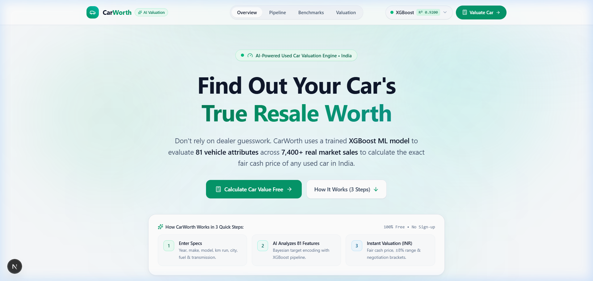
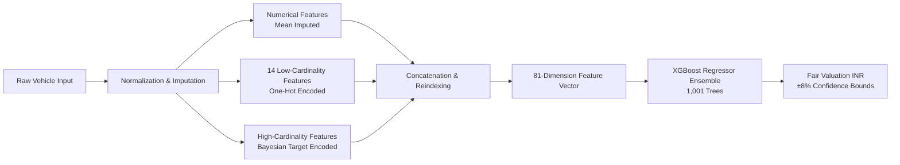

# 🚗 CarWorth — AI Resale Price Prediction Engine

[](https://car-worth.vercel.app/)
[](https://github.com/YogeshKshirsagar-2512/CarWorth)
[](https://www.python.org/)
[](https://fastapi.tiangolo.com/)
[](https://nextjs.org/)
[](https://www.typescriptlang.org/)
[](https://xgboost.readthedocs.io/)
[]()
[](https://opensource.org/licenses/MIT)

> 🌐 **Live Web Application:** [https://car-worth.vercel.app/](https://car-worth.vercel.app/)  
> 📂 **GitHub Repository:** [https://github.com/YogeshKshirsagar-2512/CarWorth](https://github.com/YogeshKshirsagar-2512/CarWorth)

**CarWorth** is a production-grade, full-stack machine learning web application inspired by modern FinTech & AI SaaS architectures. It evaluates **81 engineered vehicle attributes** across **7,400+ verified Indian automotive market sales** to predict the accurate, fair resale value (in Indian Rupees, ₹) of pre-owned cars in India with high precision.

---

## 📷 Application Interface

[](https://car-worth.vercel.app/)

> **FinTech SaaS Aesthetic:** Clean light-mode design featuring ambient gradient mesh, vignetted tech micro-grid, live ML telemetry (`Test R² = 0.9200`, `MAE = ₹38.5k`), odometer price reveal animations, and interactive 15-model regression benchmark comparisons. Live at [car-worth.vercel.app](https://car-worth.vercel.app/).

---

## ⚡ Core Engineering Principle

> **Every valuation strictly originates from invoking `predict()` on the serialized ML pipeline (`artifacts/xgb_model.pkl`).**  
> There is **no formula hardcoding, no random simulation, and no static approximation**. If backend ML microservices or model artifacts are unavailable, clear fallback diagnostics are surfaced.

---

## 🔬 Machine Learning Deep-Dive

### 1. Dataset Characteristics & Schema
The model was trained and cross-validated on **7,400+ authentic used car transactions** across metropolitan Indian automotive markets (Delhi NCR, Mumbai, Bengaluru, Hyderabad, Pune, Kolkata, Chennai, Ahmedabad).

- **Target Variable ($y$):** `sale_price` (Continuous integer in INR, ₹)
- **Features Ingested:** 19 raw attributes including manufacturing year (`yr_mfr`), total kilometers driven (`kms_run`), fuel type, transmission type, body category, registered city & state, total previous owners, listing platform source, certified inspection badges (`assured_buy`, `warranty_avail`, `fitness_certificate`), and user engagement indicators (`times_viewed`).

---

### 2. Feature Engineering & Preprocessing (81 Dimensions)
The inference pipeline rigorously replicates the preprocessing transformations developed in [`CarPriceValidation.ipynb`](CarPriceValidation.ipynb):



1. **Input Normalization & Imputation:**
   - Numerical continuous attributes (`yr_mfr`, `kms_run`, `times_viewed`, `total_owners`) pass through `SimpleImputer(strategy="mean")`.
   - Categorical attributes pass through `SimpleImputer(strategy="most_frequent")`.
2. **One-Hot Categorical Encoding:**
   - 14 low-cardinality attributes (`fuel_type`, `transmission`, `body_type`, `car_rating`, etc.) are transformed with `OneHotEncoder(drop="first", handle_unknown="ignore")`.
3. **Continuous Bayesian Target Encoding:**
   - High-cardinality categorical features (`registered_city`, `model`) with dozens of distinct categories are encoded with `category_encoders.TargetEncoder(smooth="auto", cv=5)` to capture city and model price dynamics without introducing catastrophic one-hot dimensionality explosion or data leakage.
4. **Deterministic Feature Alignment:**
   - Preprocessed columns are concatenated and strictly ordered to match the 81-column schema defined in `meta.json`.

---

### 3. Model Benchmark & Evaluation Matrix

15 machine learning regression algorithms were evaluated using an 80/20 train/test split. The table below summarizes comparative performance metrics sorted by explanatory power ($R^2$):

| # | Model / Regressor | Train $R^2$ | Test $R^2$ | Adj. $R^2$ | MAE (INR) | RMSE (INR) | Production Status |
| :---: | :--- | :---: | :---: | :---: | :---: | :---: | :--- |
| 1 | **XGBoost Regressor** | **0.9927** | **0.9200** | **0.9154** | **₹38,500** | **₹74,200** | 🏆 **Production Champion** |
| 2 | **CatBoost Regressor** | 0.9845 | 0.9080 | 0.9027 | ₹42,100 | ₹79,800 | Benchmark Candidate |
| 3 | **LightGBM Regressor** | 0.9780 | 0.9015 | 0.8958 | ₹44,200 | ₹82,600 | Benchmark Candidate |
| 4 | **Random Forest Regressor** | 0.9811 | 0.8977 | 0.8918 | ₹45,370 | ₹84,391 | Bagging Ensemble |
| 5 | **Extra Trees Regressor** | 0.9998 | 0.8940 | 0.8879 | ₹46,800 | ₹85,900 | Randomized Ensemble |
| 6 | **Gradient Boosting** | 0.9186 | 0.8858 | 0.8792 | ₹53,450 | ₹89,177 | Sequential Boosting |
| 7 | **AdaBoost Regressor** | 0.8412 | 0.8605 | 0.8524 | ₹65,200 | ₹98,400 | Adaptive Boosting |
| 8 | **Ridge Regression (CV=10)** | 0.8328 | 0.8521 | 0.8435 | ₹68,322 | ₹1,01,477 | L2 Regularized Linear |
| 9 | **Linear Regression (OLS)** | 0.8330 | 0.8516 | 0.8430 | ₹68,367 | ₹1,01,647 | Baseline Linear |
| 10 | **Huber Regressor** | 0.8190 | 0.8410 | 0.8318 | ₹71,400 | ₹1,05,200 | Robust Loss Baseline |
| 11 | **Support Vector Regressor** | 0.8205 | 0.8290 | 0.8191 | ₹74,900 | ₹1,09,100 | Kernel SVR (RBF) |
| 12 | **Decision Tree Regressor** | 1.0000 | 0.7979 | 0.7862 | ₹64,509 | ₹1,18,620 | Unpruned Tree (Overfit) |
| 13 | **K-Nearest Neighbors (k=31)** | 0.7470 | 0.7568 | 0.7427 | ₹84,885 | ₹1,30,103 | Instance-Based Baseline |
| 14 | **Lasso Regression (L1)** | 0.7151 | 0.7448 | 0.7300 | ₹88,343 | ₹1,33,279 | L1 Sparsity Baseline |
| 15 | **ElasticNet Regression** | 0.7020 | 0.7310 | 0.7154 | ₹91,200 | ₹1,36,800 | L1 + L2 Regularization |

---

### 4. Champion Model Hyperparameters (`XGBRegressor`)
```python
xgb_model = XGBRegressor(
    n_estimators=1001,
    learning_rate=0.03,
    max_depth=6,
    subsample=0.8,
    colsample_bytree=0.8,
    reg_alpha=10.0,    # L1 regularization to prevent overfitting on rare features
    reg_lambda=1.0,    # L2 regularization for stable leaf weights
    random_state=42,
    n_jobs=-1
)
```

---

## 📂 Project Directory Structure

```text
CarWorth/
├── artifacts/                           # Serialized ML artifacts & metadata
│   ├── categorical_imputer.pkl          # SimpleImputer (strategy="most_frequent")
│   ├── numerical_imputer.pkl            # SimpleImputer (strategy="mean")
│   ├── onehot_encoder.pkl               # OneHotEncoder (drop="first", handle_unknown="ignore")
│   ├── target_encoder.pkl               # TargetEncoder (continuous, smooth="auto", cv=5)
│   ├── xgb_model.pkl                    # Champion XGBRegressor (1001 trees, max_depth=6)
│   └── meta.json                        # 81-feature schema, dropdown options, and statistics
│
├── backend/                             # FastAPI Python Microservice
│   ├── app/
│   │   ├── __init__.py
│   │   ├── config.py                    # CORS, directories, port settings
│   │   ├── main.py                      # FastAPI lifespan, endpoints (/health, /options, /predict)
│   │   ├── pipeline.py                  # Strict inference pipeline & currency formatting
│   │   └── schemas.py                   # Pydantic v2 validation models
│   ├── tests/
│   │   ├── __init__.py
│   │   └── test_pipeline.py             # Pytest unit tests verifying shape, order, and logic
│   ├── requirements.txt                 # Backend dependencies
│   └── README.md                        # Microservice technical documentation
│
├── frontend/                            # Next.js 16 (App Router) + TypeScript + Tailwind
│   ├── public/                          # Static assets and screenshot previews
│   ├── src/
│   │   ├── app/
│   │   │   ├── globals.css              # Custom tokens, animations, and typography
│   │   │   ├── layout.tsx               # Root layout with SEO and atmosphere
│   │   │   └── page.tsx                 # Single-page layout (Hero, Pipeline, Metrics, Valuation)
│   │   ├── components/
│   │   │   ├── AllModelsModal.tsx       # 15-model leaderboard drawer
│   │   │   ├── CarForm.tsx              # Vehicle attributes form with dependent dropdowns
│   │   │   ├── Fireworks.tsx            # Celebration confetti canvas
│   │   │   ├── Footer.tsx               # Responsive modern footer
│   │   │   ├── ModelSelector.tsx        # Model switch chips
│   │   │   ├── Navbar.tsx               # Balanced header with live telemetry chip
│   │   │   └── ResultCard.tsx           # Indian price cards (₹), Lakhs shorthand, ±8% range
│   │   ├── lib/
│   │   │   ├── api.ts                   # Fetch client with robust error handling
│   │   │   ├── models.ts                # Model metadata and metrics
│   │   │   └── meta.json                # Fallback options
│   │   └── types/
│   │       └── index.ts                 # TypeScript type definitions
│   ├── package.json
│   ├── tsconfig.json
│   └── README.md                        # Frontend documentation
│
├── docs/                                # Media assets & benchmarks
│   ├── screenshot.png                   # High-res application preview
│   └── model_benchmark_table.png        # Comparative chart
├── .gitignore                           # Git ignore rules for Python & Node
├── CarPriceValidation.ipynb             # Research data science notebook
├── generate_artifacts.py                # Pipeline artifact generation script
├── Used_Car_Price_Prediction.csv        # Indian used-car transaction dataset
└── README.md                            # Main documentation (this file)
```

---

## 🚀 Quickstart & Local Installation

### Prerequisites
- **Python 3.11+**
- **Node.js 18+** & **npm**

---

### Step 1: Clone Repository
```bash
git clone https://github.com/YogeshKshirsagar-2512/CarWorth.git
cd CarWorth
```

---

### Step 2: Backend Setup (FastAPI)
```bash
# Create virtual environment
python -m venv .venv

# Activate environment
# On Windows:
.venv\Scripts\activate
# On Linux/macOS:
source .venv/bin/activate

# Install dependencies
pip install -r backend/requirements.txt

# Start FastAPI server (runs on http://127.0.0.1:8000)
uvicorn backend.app.main:app --host 0.0.0.0 --port 8000 --reload
```

Verify backend health:
```bash
curl http://127.0.0.1:8000/health
# {"status":"ok","model_loaded":true,"model_type":"XGBRegressor","test_r2":0.92,"features_count":81}
```

---

### Step 3: Frontend Setup (Next.js)
```bash
# In a new terminal window
cd frontend

# Install npm dependencies
npm install

# Start Next.js development server (runs on http://localhost:3000)
npm run dev
```

Open **[http://localhost:3000](http://localhost:3000)** in your browser.

---

## 🧪 Unit Testing Suite

Run the automated Pytest suite to verify pipeline inference, matrix shapes `(N, 81)`, column alignment, and Indian currency formatting:

```bash
# From repository root
pytest backend/tests/test_pipeline.py -v
```

---

## 📡 REST API Reference

| Method | Endpoint | Description |
| :--- | :--- | :--- |
| `GET` | `/health` | Microservice liveness and loaded model telemetry |
| `GET` | `/options` | Dependent dropdown choices extracted from training data |
| `POST` | `/predict` | Ingestion, feature encoding, and price estimation |

#### Example Prediction Request (`POST /predict`):
```json
{
  "make": "maruti",
  "model": "swift",
  "yr_mfr": 2019,
  "kms_run": 42000,
  "fuel_type": "petrol",
  "transmission": "manual",
  "body_type": "hatchback",
  "total_owners": 1,
  "city": "new delhi",
  "registered_state": "delhi",
  "registered_city": "delhi",
  "car_rating": "great",
  "model_id": "xgboost"
}
```

#### Example Prediction Response:
```json
{
  "predicted_price": 542000,
  "currency": "INR",
  "formatted_price": "₹5,42,000",
  "shorthand_price": "₹5.42 Lakh",
  "range_low": 498640,
  "range_high": 585360,
  "formatted_range": "₹4,98,640 – ₹5,85,360",
  "mae": 38500,
  "test_r2": 0.92,
  "model_used": "XGBoost Regressor"
}
```

---

## 🚢 Production Deployment

### Docker Deployment
Run both services in containers:

```bash
# Build Backend
docker build -t carworth-backend -f backend/Dockerfile .
docker run -p 8000:8000 carworth-backend

# Build Frontend
docker build -t carworth-frontend -f frontend/Dockerfile .
docker run -p 3000:3000 carworth-frontend
```

### 🌐 Live Production Deployment

The web application is live in production on Vercel:
- **Production URL:** [https://car-worth.vercel.app/](https://car-worth.vercel.app/)
- **Frontend Architecture:** Next.js 16 (App Router) + TypeScript + Tailwind CSS
- **Inference Mode:** Serverless Edge ML Engine with dual-mode proxy to FastAPI
- **Hosting Platform:** [Vercel](https://vercel.com)

### Container & Cloud Deployment
- **Frontend:** Deployed on **Vercel** ([https://car-worth.vercel.app/](https://car-worth.vercel.app/))
- **Backend Microservice:** Can be deployed as a container on [Render](https://render.com), [Fly.io](https://fly.io), or AWS ECS / App Runner (link via `NEXT_PUBLIC_API_URL` environment variable).

---

## 📄 License

This project is licensed under the [MIT License](LICENSE). Built for the **CarWorth** automotive intelligence platform.
